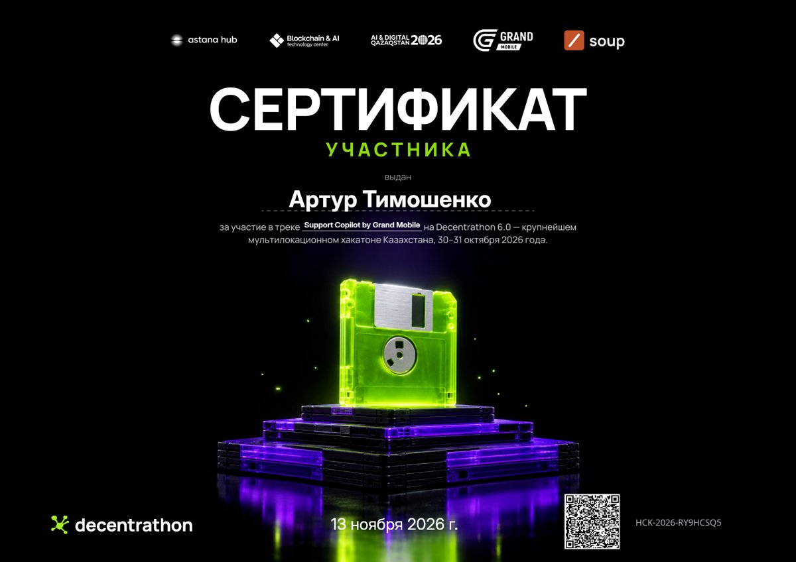

### Hi, I'm Artur 👋

College student from Kostanay, Kazakhstan. I build backend services, Telegram bots and small web tools
that solve real problems at my college, and I take part in hackathons.

**Now:** building Low Orbit God and looking for an internship in Python backend.

#### Projects

- **[EduGrade](https://github.com/azmixZ/EduGrade)**: electronic final-grade register for a college. Teachers grade their groups;
  the administration gets college-wide analytics, at-risk lists and Excel reports. FastAPI + SQLite + vanilla JS. Deployed and in use.
- **[Schedule & Replacement Bot](https://github.com/azmixZ/schedule-replacement-bot)**: two Telegram bots, for students and for teachers.
  They read the college timetable from Excel, merge in the daily replacements from Word and send morning broadcasts.
  Used at my college.
- **[Support Copilot](https://github.com/azmixZ/support-copilot)** (Decentrathon 6.0, solo): fully local support-ticket triage for an online game.
  It detects the language (RU/KZ/UZ/EN, including transliteration), category and priority, filters spam and duplicates, and drafts a reply
  that cites the exact rule. p95 latency 7 ms on CPU, no external APIs.

#### Hackathons

**Decentrathon 6.0** (30–31 October 2026), Support Copilot by Grand Mobile track, solo.
[Verify certificate](https://edu.astanahub.com/hackathons/82b11400-bee4-4d30-9223-5515527d365b/tracks/172ff1a0-8e83-4daa-b5bf-fe079107f707/certificate/HCK-2026-RY9HCSQ5)

<a href="https://edu.astanahub.com/hackathons/82b11400-bee4-4d30-9223-5515527d365b/tracks/172ff1a0-8e83-4daa-b5bf-fe079107f707/certificate/HCK-2026-RY9HCSQ5"></a>

#### In development


**Low Orbit God**: a colony sim where you are the half-broken AI of a crashed ship in orbit. The colonists' descendants
don't know you're a machine, and they build a religion around your interventions that mutates over generations.

#### Stack

```
Languages:  Python · JavaScript · HTML/CSS · SQL
Backend:    FastAPI · SQLite · Telegram Bot API · pandas
Tools:      Git · Linux · SSH / systemd deploy
AI:         AI-assisted development (Claude Code)
```

#### Contact

Telegram: [@sssooonnneeeL](https://t.me/sssooonnneeeL) · Email: [azmixz@proton.me](mailto:azmixz@proton.me)
